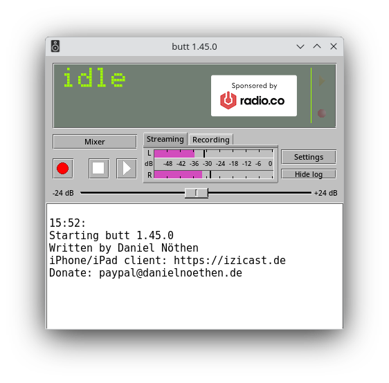
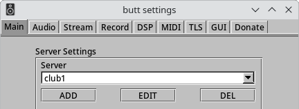
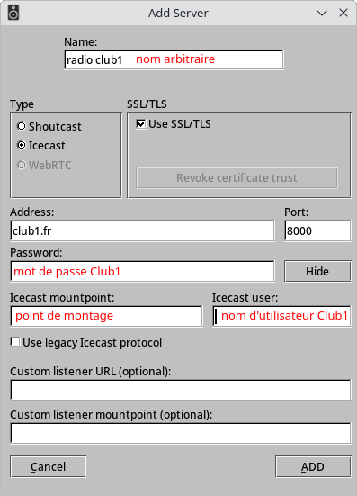
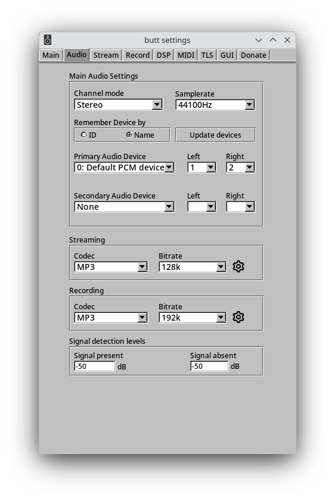
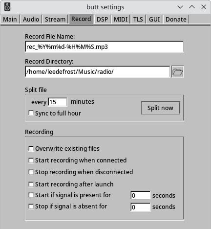
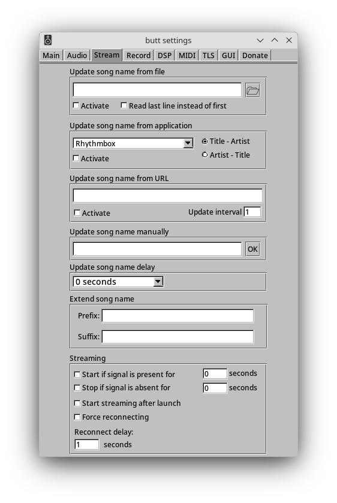

Tutoriel BUTT
=============

Il existe différentes manières d'exploiter le service [webdiffusion de CLUB1](/services/webcast.md).
On peut par exemple diffuser des emission en live depuis un ordinateur connecté à {term}`Internet`.
Pour ça, on aime bien utilier le logiciel {logiciel}`BUTT`, parcequ'il est assez simple, gratuit et open source.


Qu'est ce que c'est BUTT
------------------------

```{logiciel} BUTT
(_Broadcast Using This Tool_) {term}`Logiciel libre` qui permet de capturer le son de l'ordinateur
ou d'une interface audio externe de l'animateur·ice radio pour l'envoyer vers le serveur
sur lequel est installé le logiciel de {term}`webdiffusion` ({logiciel}`Icecast` sur CLUB1).

BUTT permet à la fois de **diffuser** des emissions radio et de les **enregistrer** en local,
ainsi que d'y ajouter des métadonnées et de mixer plusieurs sources. ---
[Site Web](https://danielnoethen.de/butt/) 
```


Interface
---------



De haut en bas, l'interface montre :

- Un écran de monitoring qui affiche **l'etat du stream**, **sa durée**, **son poid**,
  **l'etat de l'enregistrement**, **sa durée** et **son poid**.
  Il affiche aussi le nombre d'autiteur·ices connectées sur le flux.
- Un bouton {guilabel}`Mixer` dans le cas ou on utilise **plusieurs interfaces audio** (usage avancé)
- Un bouton {guilabel}`🔴 Rec` pour enregistrer le son entrant
- Un bouton {guilabel}`▶️ Play` pour lancer la diffusion
- Un bouton {guilabel}`⏹️ Stop` pour arreter les deux précédents.
- Un **vu-metre** avec deux onglets, qui affiche le niveau de sortie vers le stream et vers l'enregistrement.
- Un slider de **gain** pour éviter la saturation (vu-metre dans le rouge)
- Un boutton {guilabel}`Settings` pour afficher la fenêtre de configuration
- Un boutton {guilabel}`Show log` pour afficher le journal d'evenement
  qui garde trace de toute opérations lancées et eventuels problemes


Configuration du serveur
------------------------

Pour permettre à BUTT d'envoyer le flux audio vers le serveur,
il faut l'informer de l'adresse de ce serveur et le port à travers lequel il pourra acceder à Icecast.


En appuyant sur le bouton {guilabel}`Settings` on peut afficher la fenêtre des parametres.
Dans l'onglet {guilabel}`Main` un encart {guilabel}`Server Settings` permet de choisir parmis différents serveurs enregistrés.



Les boutons en dessous permettent d'ajouter ou d'éditer un serveur enregistré.



De haut en bas il faut remplir ces cases :

- {guilabel}`Name` : il n'a pas d'incidence sur la connexion,
  il vous permet de vous y retrouver parmis divers serveurs sur lesquels vous pourrier vouloir vous connecter.
- {guilabel}`Type` : quel logiciel de streaming est installé sur le serveur visé. **Icecast** chez club1.
- {guilabel}`SSL/TLS` (_Secure Sockets Layer_ / _Transport Layer Security_) : protocole de chiffrement, **oui** sur club1.
- {guilabel}`Adress` : il s'agit de l'adresse du serveur `club1.fr` en l'occurence
- {guilabel}`Port` : le port sur lequel est installé Icecast. `8000` chez club1.
- {guilabel}`Password` : le mot de passe de votre compte club1
- {guilabel}`Icecast Mountpoint` : icecast peut diffuser plusieurs streams en simultané.
  Chaque stream est identifié par un _mountpoint_ (point de montage)
  qui sera indiqué dans l'adresse via laquel l'auditeur·ice accedera au stream.
  Ex : Mountpoint : `labonne radio` -> url : `club1.fr:8000/labonneradio`
- {guilabel}`Icecast user` : votre identifiant club1
- {guilabel}`Use legacy icecast protocol` : laisser vide.

{guilabel}`Custom listener url` et {guilabel}`custom listener mountpoint` peuvent rester vide.

### Adresse du flux

D'apres ces informations de connection vous pouvez déduire l'adresse du stream audio,
que vous pouvez écouter directement sur le navigateur ou bien intégrer à une balise `<audio>` sur un site web.

    https://ADRESSE_DU_SERVEUR:PORT/MOUNTPOINT

Exemple :

    https://club1.fr:8000/labonneradio

Et pour afficher le player sur un site en HTML :

```html
<audio controls src="https://club1.fr:8000/labonneradio"></audio>
```

Configuration des entrées audio
-------------------------------

Des miliers d'internautes peuvent maintenant cliquer sur le player de votre radio. Mais que vont iels entendre ?

Vous pouvez leur parler depuis le micro de votre ordinateur, ou bien brancher un microphone à une carte son,
ou pleins d'instruments et de microphones sur une table de mixage avec une carte son intégrée...

Dans tous les cas il va falloir l'indiquer à BUTT.

Dans l'onglet {guilabel}`Audio` de la fenêtre de configuration vous pouvez indiquer l'**Audio device** que vous allez utiliser.



- {guilabel}`Channel mode` : mono ou stéréo (gauche et droite).
- {guilabel}`Samplerate` : fréquence d'échantillonage, (valeur par défault ok)
- {guilabel}`Update device` : si vous ne trouvez pas votre instrument dans la liste,
  essayez d'actualiser la liste (ex: carte son branchée après l'allumage de BUTT)
- {guilabel}`Primary audio device` : Selectionner sa carte son, (Attention à bien installer le pilote).
  Il est possible parfois de selectionner le microphone interne et même parfois de capturer le son de l'ordinateur
  (utile pour une emission musicale sans voix ou de rediffusion)

Il est possible de brancher plusieurs interfaces audio/ cartes son sur BUTT.
Le Mixer permet de mélanger les deux signaux (usage avancé).

```{warning}
Pensez à tester le son depuis un navigateur pour s'assurer que le flux fonctionne correctement :
un mauvais paramétrage des interfaces audio ne se verra pas de votre côté
mais peut rendre l'emission inaudible pour les auditeur·ice·s
```

Sur cette même page, vous pouvez indiquer le codec de compression de l'audio de votre stream.

```{note}
Nous conseillons `mp3` car les navigateur Apple risquent de boycotter le `ogg/vorbis` et vous perdez tous les iphones...
Le **bitrate** par défault est convenable (sur le fil du rasoir entre qualité et legerté...).
```

Vous pouvez indiquer aussi le codec et la qualité de votre enregistrement !
Attention toutefois à avoir la place necessaire sur son ordinateur
si l'on veut un recording de haute qualité qui sera plus lourd.


Enregistrement du flux
----------------------

Pour garder une trace de votre emission live
vous pouvez utiliser BUTT pour enregistrer votre emission
en appuyant sur le bouton REC rouge avant de lancer le stream.

L'onglet {guilabel}`recording` de la fenetre de configuration permet de paramétrer cet enregistrement
(en plus des options de compression et qualité citée plus haut).



La valeur par défault dans {guilabel}`Record File Name` montre une nomanclature
qui permet de generer des noms de fichiers dynamiques qui integrent la date et l'heure.

    rec_%Y%m%d-%H%M%S.mp3

Donnera par exemple

    rec_20260707-112202.mp3

Vous pouvez l'editer à votre souhait pour vous y retrouver dans vos fichiers

    labonneradio_saison1_%Y/%m/%d-%H:%M:%S.mp3

Donnera par exemple

    labonneradio_saison1_2026/11/06-23:12:41.mp3

```{tip}
Ce systeme de nommage dynamique vous permet de ne pas écraser des fichiers qui ont le même nom.
```

Le bouton {guilabel}`split file` coupe et relance directement l'enregistrement.
Ça peut etre utile quand on a plus de batterie sur un ordinateur
et qu'on veut s'assurer de bien garder une partie de l'enregistrement.
Ou bien pour séquencer des chapitres d'une emission pour faciliter le travail d'archivage ensuite.
Il est possible d'automatiser cette coupure pour avoir des fichiers correspondant à chaque heure ou demi-heure de diffusion.

Information textuelles
----------------------

Il est possibe de passer d'autre données que le flux audio comme le nom de l'emission en cours, le titre d'une musique.
Ces infos peuvent être réccupérées sur la page web avec du javascript.

```{note}
Ces options doivent être experimentées afin d'être mieux documentées.
```




GUI
---

Peut être avec vous remarqué que votre fênetre ne ressemblait pas tout à fait à celle sur ce tutoriel...


Pour aller plus loin
--------------------

Vous devriez pouvoir faire des bêtes d'émissions avec ça déjà
mais n'hésitez pas à explorer d'avantage les autres onglets du menu de configuration
qui permettent de paramettrer des controlleurs en MIDI, de traiter du signal audio entrant.
